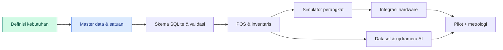

# Smart Casier

**Aplikasi Windows:** [Simulator v0.4](docs/VIRTUAL_DEVICE_PROTOCOL_V0_4.md) · [Panduan WPF](docs/WINDOWS_DESKTOP_V0_1.md) · [Login Admin/Kasir v0.3](docs/LOCAL_AUTH_V0_3.md) · [Riwayat dan backup/restore](docs/SALES_HISTORY_AND_BACKUP.md) · [CI terbaru Windows/Linux](https://github.com/Skyreaaa/smart-casier/actions/runs/44291496358)

**Execution policy (18 Nov 2026):** [SOFTWARE ONLY — tugas fisik ditunda dan dicatat](docs/EXECUTION_POLICY_SOFTWARE_ONLY.md). Pengujian/pendataan fisik **bukan prasyarat implementasi software**; wajib sebelum deploy toko/komersial.

> **Status: Software-Only Windows Desktop v0.4 (Operator + Simulator) + Database Foundation + Non-food Staging** — skema SQLite, importer CSV, filter non-makanan, **adapter katalog Open Products Facts dan master spare part**, serta pengujian CI tersedia. **261 kandidat metadata dari sumber luar tetap ditahan untuk review hak pakai; 0 SKU toko nyata diverifikasi dan 0 kandidat eksternal masuk master POS.**

   

**Update terakhir:** 18 November 2026 · **Repository:** private · **Branch:** `main`

**Hasil kurasi data asli:** [Audit dan hasil 18 November](docs/REAL_NONFOOD_INTAKE_2026-11-18.md) · [Laporan JSON](data/reports/real_nonfood_intake_2026-11-18.json) · [GitHub CI (47 lulus)](https://github.com/Skyreaaa/smart-casier/actions/runs/44273327558)

**Sumber non-makanan:** [Audit lisensi dan relevansi](docs/SOURCE_AUDIT_2026-11-18.md) · [Panduan dua adapter](docs/NONFOOD_INTAKE.md)

**Dataset non-makanan:** [Pipeline staging](docs/DATASET_STAGING.md) · [Sumber kandidat](data/sources/nonfood_registry.json) · [Contoh sintetis](data/examples/nonfood_staging_demo.csv) · [Staging schema](database/migrations/002_dataset_staging.sql)

**Database:** [Panduan pendataan](docs/DATABASE_FOUNDATION.md) · [Template CSV kosong](data/templates/catalog_products.csv) · [Migrasi SQLite](database/migrations/001_core.sql) · [Hasil CI](https://github.com/Skyreaaa/smart-casier/actions/runs/44265209926)

**Baca:** [Laporan progres lengkap](docs/PROGRESS.md) · [Roadmap dan milestone](docs/ROADMAP.md) · [Riwayat perubahan](docs/CHANGELOG.md)

## Status per fase

| Area | Selesai | Progres checklist | Kondisi nyata |
| --- | ---: | --- | --- |
| Discovery & scope | 4/5 | ▰▰▰▰▰▰▰▰▱▱ 80% | Dalam finalisasi |
| Repository & dokumentasi | 2/4 | ▰▰▰▰▰▱▱▱▱▱ 50% | Aktif |
| Fondasi database | 5/6 | ▰▰▰▰▰▰▰▰▱▱ 83% | Skema + importer + CI siap; butuh 30 SKU nyata |
| POS & inventaris | 2/6 | ▰▰▰▱▱▱▱▱▱▱ 33% | Variasi pcs/meter + keranjang/checkout dasar diuji; CRUD penuh masih parsial |
| Simulator perangkat | 3/5 | ▰▰▰▰▰▰▱▱▱▱ 60% | Mock scanner/encoder + kontrak diuji; fisik belum |
| Visi komputer & pilot | 0/6 | ▱▱▱▱▱▱▱▱▱▱ 0% | Fase lanjutan |

**Interpretasi:** 16 dari 32 checklist selesai (50% checklist, bukan kesiapan produksi). **Checkout dan akses histori/struk sekarang membutuhkan operator aktif di Core. Scanner dan encoder virtual memakai event unik dengan ACK/retry; 71 tes/OS lulus.** UX WPF belum diuji langsung, disconnect/timeout dan perangkat fisik belum diuji. **0 SKU toko terverifikasi.**

## Alur pekerjaan

## Yang sudah diputuskan

- POS Windows **offline-first**, PC kasir sudah ada.
- Barcode + pencarian manual; kamera AI direncanakan untuk kandidat barang tanpa barcode, bukan penentu SKU tanpa verifikasi.
- Alat ukur material lembaran: target via keypad, panjang dikirim melalui USB, **kasir memilih material/warna dan mengonfirmasi**.
- Inventaris dengan stok per SKU dan satuan; laporan **stok habis** dan **stok menipis** (ambang per SKU, default 3 untuk satuan pcs).
- **Batas perangkat tambahan Rp10 juta**; estimasi RAB awal belum merupakan penawaran harga dan dapat direvisi setelah prototipe.

## Non-food dataset intake (fase paralel)

| Indikator | Kondisi |
| --- | --- |
| Scope | Spare part, baut, perkakas, pipa, material lembaran, listrik, pulsa |
| Makanan/minuman | **Tidak termasuk**; record out-of-scope dikarantina |
| Sumber eksternal kandidat | 6; seluruhnya **PENDING** persetujuan penggunaan |
| Data eksternal yang masuk master POS | **0 SKU** |
| Kandidat hasil kurasi sumber nyata | **261 nama produk**; seluruhnya **HOLD_LICENSE** pada staging pengujian terpisah |
| Pipeline SQLite | Staging + 3 adapter; converter sumber PRDECT telah dijalankan pada data nyata |
| Quality gates | Kategori non-food, nama duplikat, barcode bila tersedia, sumber/lisensi, reviewer, audit |

Pipeline dan kebijakan impor ada di [dokumen staging](docs/DATASET_STAGING.md). [Hasil ekstraksi data asli](docs/REAL_NONFOOD_INTAKE_2026-11-18.md) mencantumkan 261 kandidat yang **belum disetujui**. Dataset sintetis untuk CI bukan inventaris toko.

## Aplikasi Windows yang sudah tersedia

- **WPF Desktop:** login operator, katalog/keranjang/checkout, histori receipt dan simulator input barcode/encoder virtual.
- **Otorisasi lokal:** Admin pertama dibuat sendiri, tanpa password bawaan; Admin dapat membuat akun Kasir. Fungsi edit katalog dan backup/restore memeriksa sesi Admin di Core, bukan sekadar tombol.
- **Editor produk:** tambah SKU, harga baru dan koreksi stok berserta alasan. Pengelolaan metadata lengkap, hapus/nonaktif SKU dan hak akses masih backlog.
- **Database terpisah:** `%LOCALAPPDATA%\\SmartCasier\\pos.db` dan `demo-pos.db` khusus simulasi.
- **Distribusi:** paket `smart-casier-windows-demo` di [GitHub Actions](https://github.com/Skyreaaa/smart-casier/actions/runs/44291496358); butuh .NET 10 Desktop Runtime (x64).
- **Backup/restore aman:** backup online WAL yang diverifikasi, restore hanya ke file BARU; database aktif tidak ditimpa. Memerlukan Admin tetapi file backup belum terenkripsi.
- **Bukti:** build WPF dan **71 tes per platform** (POS/katalog/history/backup/auth/device) lulus Windows & Linux. Belum ada GUI automation, tes pengguna, atau pemulihan aktif end-to-end.

## Software POS yang sudah tersedia

- **.NET 10 + SQLite:** checkout fisik atomik, item PCS/meter, receipt snapshot, uang kembalian dan idempotensi request.
- **Pencarian:** SKU, nama, label varian, barcode dan alias; stok habis/menipis dari ledger.
- **CLI demo tanpa hardware:** `init`, `seed-demo`, `search`, `stock`. Checkout CLI sekarang dinonaktifkan karena transaksi memerlukan login WPF.
- **Verifikasi:** 13 skenario integrasi POS, build/test di Windows dan Linux [CI sukses](https://github.com/Skyreaaa/smart-casier/actions/runs/44276517575).
- **Belum:** CRUD lengkap, backup terjadwal/terenkripsi, aktivasi restore, perangkat fisik, simulasi disconnect/timeout, hardening akses file SQLite, autentikasi pada seluruh API baca, reset password, pemrosesan pulsa dan data toko nyata.

## Tugas langsung berikutnya

1. **Software:** lanjutkan fitur histori transaksi, backup/restore SQLite yang aman, dan akses admin sebelum pengujian UI.
2. **Software:** lengkapi pengelolaan SKU (edit nama/varian, nonaktifkan, audit harga), inventaris dan penanganan error.
3. **Software:** simulator scanner barcode dan perangkat ukur dengan antarmuka adapter yang bisa diganti.
4. **DEFERRED_ON_SITE:** 30 SKU asli, perangkat fisik, kalibrasi, uji toko dan metrologi tetap dicatat [di sini](docs/EXECUTION_POLICY_SOFTWARE_ONLY.md).

> Dashboard dibuat sebagai laporan *manual snapshot*. Perbarui centang di `docs/PROGRESS.md` dan sinkronkan angka/diagram di README serta SVG saat pekerjaan benar-benar selesai; tidak ada klaim otomatisasi progres dari GitHub Actions.
