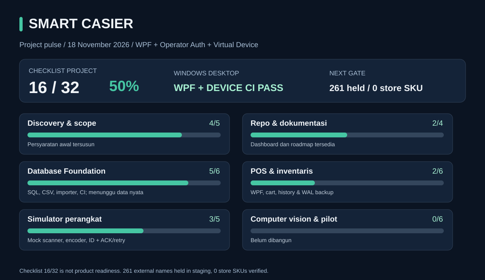
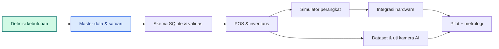

# Smart Casier

> **Status: tahap perencanaan & pengumpulan data** — aplikasi POS, hardware, dan machine learning belum diimplementasikan.

   

**Update terakhir:** 18 November 2026 · **Repository:** private · **Branch:** `main`

**Baca:** [Laporan progres lengkap](docs/PROGRESS.md) · [Roadmap dan milestone](docs/ROADMAP.md) · [Riwayat perubahan](docs/CHANGELOG.md)

## Status per fase

| Area | Selesai | Progres checklist | Kondisi nyata |
| --- | ---: | --- | --- |
| Discovery & scope | 4/5 | ▰▰▰▰▰▰▰▰▱▱ 80% | Dalam finalisasi |
| Repository & dokumentasi | 2/4 | ▰▰▰▰▰▱▱▱▱▱ 50% | Aktif |
| Fondasi database | 0/6 | ▱▱▱▱▱▱▱▱▱▱ 0% | Prioritas berikutnya |
| POS & inventaris | 0/6 | ▱▱▱▱▱▱▱▱▱▱ 0% | Belum dimulai |
| Simulator perangkat | 0/5 | ▱▱▱▱▱▱▱▱▱▱ 0% | Belum dimulai |
| Visi komputer & pilot | 0/6 | ▱▱▱▱▱▱▱▱▱▱ 0% | Fase lanjutan |

**Interpretasi:** 6 dari 32 checklist selesai, mayoritas berupa kesepakatan scope dan dokumentasi. **Belum ada fitur transaksi, database SQLite, kamera AI, maupun alat ukur yang sudah bekerja.**

## Alur pekerjaan

## Yang sudah diputuskan

- POS Windows **offline-first**, PC kasir sudah ada.
- Barcode + pencarian manual; kamera AI direncanakan untuk kandidat barang tanpa barcode, bukan penentu SKU tanpa verifikasi.
- Alat ukur material lembaran: target via keypad, panjang dikirim melalui USB, **kasir memilih material/warna dan mengonfirmasi**.
- Inventaris dengan stok per SKU dan satuan; laporan **stok habis** dan **stok menipis** (ambang per SKU, default 3 untuk satuan pcs).
- **Batas perangkat tambahan Rp10 juta**; estimasi RAB awal belum merupakan penawaran harga dan dapat direvisi setelah prototipe.

## Tugas langsung berikutnya

1. Definisikan kolom master produk, kategori, varian dan unit dasar stok.
2. Buat skema relasi data SKU, kode barcode opsional, pemasok, persediaan dan pergerakan stok.
3. Siapkan format pengumpulan produk serta data contoh yang **secara jelas berlabel simulasi**.
4. Uji desain skema sebelum antarmuka POS dibangun.

> Dashboard dibuat sebagai laporan *manual snapshot*. Perbarui centang di `docs/PROGRESS.md` dan sinkronkan angka/diagram di README serta SVG saat pekerjaan benar-benar selesai; tidak ada klaim otomatisasi progres dari GitHub Actions.
