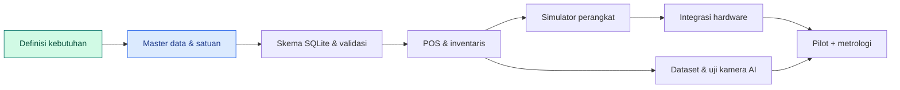

# Smart Casier

> **Status: Database Foundation v0.1** — skema SQLite, importer CSV, dan pengujian otomatis tersedia. Data toko nyata, aplikasi POS, hardware, dan AI belum diimplementasikan.

   

**Update terakhir:** 18 November 2026 · **Repository:** private · **Branch:** `main`

**Database:** [Panduan pendataan](docs/DATABASE_FOUNDATION.md) · [Template CSV kosong](data/templates/catalog_products.csv) · [Migrasi SQLite](database/migrations/001_core.sql) · [Hasil CI](https://github.com/Skyreaaa/smart-casier/actions/runs/44265209926)

**Baca:** [Laporan progres lengkap](docs/PROGRESS.md) · [Roadmap dan milestone](docs/ROADMAP.md) · [Riwayat perubahan](docs/CHANGELOG.md)

## Status per fase

| Area | Selesai | Progres checklist | Kondisi nyata |
| --- | ---: | --- | --- |
| Discovery & scope | 4/5 | ▰▰▰▰▰▰▰▰▱▱ 80% | Dalam finalisasi |
| Repository & dokumentasi | 2/4 | ▰▰▰▰▰▱▱▱▱▱ 50% | Aktif |
| Fondasi database | 5/6 | ▰▰▰▰▰▰▰▰▱▱ 83% | Skema + importer + CI siap; butuh 30 SKU nyata |
| POS & inventaris | 0/6 | ▱▱▱▱▱▱▱▱▱▱ 0% | Belum dimulai |
| Simulator perangkat | 0/5 | ▱▱▱▱▱▱▱▱▱▱ 0% | Belum dimulai |
| Visi komputer & pilot | 0/6 | ▱▱▱▱▱▱▱▱▱▱ 0% | Fase lanjutan |

**Interpretasi:** 11 dari 32 checklist selesai (34% checklist, bukan kesiapan produksi). **Skema dan importer SQLite sudah tersedia dan lulus 11 pengujian CI.** Belum ada inventaris nyata, antarmuka POS, kamera AI, atau alat ukur yang bekerja.

## Alur pekerjaan

## Yang sudah diputuskan

- POS Windows **offline-first**, PC kasir sudah ada.
- Barcode + pencarian manual; kamera AI direncanakan untuk kandidat barang tanpa barcode, bukan penentu SKU tanpa verifikasi.
- Alat ukur material lembaran: target via keypad, panjang dikirim melalui USB, **kasir memilih material/warna dan mengonfirmasi**.
- Inventaris dengan stok per SKU dan satuan; laporan **stok habis** dan **stok menipis** (ambang per SKU, default 3 untuk satuan pcs).
- **Batas perangkat tambahan Rp10 juta**; estimasi RAB awal belum merupakan penawaran harga dan dapat direvisi setelah prototipe.

## Tugas langsung berikutnya

1. Inventarisasi **minimal 30 SKU toko nyata** dari kategori berbeda menggunakan [template CSV](data/templates/catalog_products.csv).
2. Periksa SKU/varian, satuan PCS atau M, stok, harga, dan barcode opsional bersama pengelola toko.
3. Validasi hasil dengan importer dry-run, lalu audit kecocokannya dengan skema.
4. Setelah data nyata tervalidasi, mulai CRUD produk dan fitur POS core. **Demo enam SKU bukan inventaris toko**.

> Dashboard dibuat sebagai laporan *manual snapshot*. Perbarui centang di `docs/PROGRESS.md` dan sinkronkan angka/diagram di README serta SVG saat pekerjaan benar-benar selesai; tidak ada klaim otomatisasi progres dari GitHub Actions.
