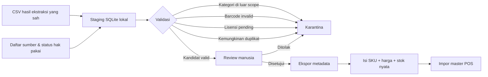

# Staging Dataset Non-Makanan — Smart Casier

**Versi:** 0.1 · **Status:** pipeline offline untuk *kurasi*, **bukan** sumber harga/stok produksi.

## Scope dataset

**Masuk:** suku cadang kendaraan, baut/mur, perkakas, kelistrikan, pipa/fitting, bahan bangunan, kertas minyak/karton/coating/material lembaran, barang rumah tangga non-makanan, dan layanan digital/pulsa.

**Tidak masuk:** makanan, minuman, snack, produk konsumsi; dataset grocery/Open Food Facts dan sejenisnya tidak digunakan untuk katalog ini.

Kategori allowlist internal yang diterima: `SPARE_PARTS`, `FASTENERS`, `PLUMBING`, `ELECTRICAL`, `TOOLS`, `SHEET_MATERIALS`, `BUILDING_MATERIALS`, `HOUSEHOLD_NONFOOD`, `DIGITAL_SERVICES`. Kategori tidak dikenal langsung dikarantina. Kata khas produk makanan yang keliru diberi kategori non-makanan juga ditahan untuk review manual.

## Sumber data Indonesia yang dicatat

| ID | Rujukan | Hak pakai/status | Tindak lanjut |
| --- | --- | --- | --- |
| `ID_MENDELEY_MOTORPARTS_2026` | [Data bengkel motor Indonesia](https://data.mendeley.com/datasets/bwyxwynbg5/1) | Laman menyatakan **CC BY 4.0**, tetapi data mencakup transaksi dan atribut pelanggan | **PENDING** review privasi/ekstraksi master part saja; jangan impor data personal |
| `ID_EKATALOG_ZENODO_2026` | [E-katalog nasional v6](https://zenodo.org/records/19604457) | Hak pakai ulang komersial belum terverifikasi | **PENDING**; file besar, kategori campuran, bukan barcode toko |
| `ID_BARCODE_GITHUB_1000` | [Daftar 1000 barcode produk Indonesia](https://github.com/wpangestu/list-barcode-product-indonesia) | Tidak ditemukan ketentuan lisensi eksplisit yang dapat dipastikan | **PENDING**; saring makanan dan cocokkan barcode secara manual |
| `ID_PRODUCT_API_GITHUB` | [API produk Indonesia](https://github.com/ariph007/api-product-indonesia) | Hak pakai ulang data belum terverifikasi; README menyatakan harga acak | **PENDING**; harga tidak boleh diimpor |
| `DEMO_SYNTHETIC_NONFOOD` | Fixture internal untuk uji CI | Contoh dibuat sendiri, bukan data produk nyata | **APPROVED** khusus pengujian |

**PENDING** berarti hanya tercatat sebagai kandidat, bukan sudah diunduh, disetujui, atau layak masuk database POS. Sebelum status suatu sumber diubah ke `APPROVED`, perlu memeriksa hak pakai, privasi, relevansi, serta provenance. **Tidak ada scraping atau panggilan API otomatis.**

## Arsitektur dataset



Dua SQLite terpisah: database staging tidak memiliki tabel transaksi POS. Tidak ada proses yang otomatis memasukkan harga, saldo persediaan, atau SKU ke katalog utama.

## Menjalankan pipeline (Python 3.11+)

```bash
# Database kurasi privat, diabaikan gitignore
python -m tools.stage_dataset --db data/private/staging.db init

# Contoh non-makanan sintetik (ada satu baris makanan untuk tes karantina)
python -m tools.stage_dataset --db data/private/staging.db ingest --source DEMO_SYNTHETIC_NONFOOD --csv data/examples/nonfood_staging_demo.csv

# Ringkasan status tiap record
python -m tools.stage_dataset --db data/private/staging.db report

# Review manual; gunakan id dari tabel SQLite staging
python -m tools.stage_dataset --db data/private/staging.db review --id 1 --decision APPROVE --reviewer admin --note "Identitas SKU sudah diperiksa"

# Ekspor yang disetujui saja. Kolom SKU, harga, stok masih kosong.
python -m tools.stage_dataset --db data/private/staging.db export --out data/private/catalog_candidates.csv

# Jalankan tes
python -m unittest discover -s tests -v
```

Perintah `init` tidak menimpa database yang sudah ada. Perintah `ingest` bersifat idempoten per (`source_id`, `external_id`): baris yang sama tidak ditambahkan dua kali, sedangkan perubahan pada external_id yang sudah ada ditolak sampai ditangani manual.

**Aturan barcode:** untuk kolom barcode GTIN, validator mengecek EAN-8, UPC-A, EAN-13, GTIN-14. Barcode yang tidak sesuai dicatat `INVALID_BARCODE`. Internal SKU atau kode rak non-GTIN jangan disisipkan ke kolom barcode GTIN; simpan sebagai kode internal setelah verifikasi toko. Prefix barcode tidak membuktikan asal produksi negara tertentu.

**Duplikasi:** barcode atau identitas produk yang sama dicatat `POSSIBLE_DUPLICATE`, bukan langsung digabung. Barang bentuk sama tetapi ukuran berbeda harus tetap menjadi kandidat varian terpisah.

## Pengolahan data masuk dari sumber luar

Dataset asli mungkin memakai CSV dengan struktur berbeda. Buat mapping manual ke [template staging](../data/templates/nonfood_staging_template.csv) memakai kolom:

`external_id, product_name, brand, category_code, variant, unit_code, barcode, attributes_json, product_url`

`external_id` harus stabil dalam sumber. Baris harus diberi kategori yang diperiksa; jangan membuat kategori dari tebakan AI tanpa tinjauan. Jangan menyalin data pelanggan atau transaksi ke katalog barang. Material kertas minyak tidak perlu barcode, tetapi nama dan varian/warna harus tersedia. Harga atau stok dari sumber publik tidak dipercaya sebagai nilai toko.

## Gate menuju database POS

- Lisensi dan asal setiap record dilacak.
- Tipe kategori dan unit disaring; makanan/minuman dikeluarkan.
- Barcode diuji checksum, kemungkinan duplikat diaudit.
- Reviewer mengesahkan identitas barang; tidak ada auto-approval.
- SKU internal, harga jual, stok awal, ambang restock dan spesifikasi barang diverifikasi terhadap toko.
- Hanya file katalog yang sudah lengkap yang boleh melewati [importer POS](../tools/import_catalog.py).

**Keterbatasan saat ini:** prosesnya belum mengunduh katalog Indonesia secara otomatis. Sumber non-makanan yang cocok dicatat untuk penilaian; dataset lokal contoh masih sintetik. Angka SKU riil terkumpul: **0**.
