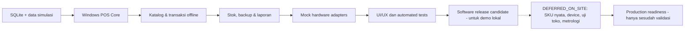

# Smart Casier — Kebijakan Pelaksanaan Software-Only

**Keputusan:** 18 November 2026 · **Mode pekerjaan aktif:** `SOFTWARE_ONLY` · **Status:** berlaku sampai arahan baru.

## Aturan wajib

1. **Prioritas pada aplikasi Windows offline-first:** model data, transaksi, pencarian katalog, inventaris, backup, UI, hardware adapter simulasi, dan automated tests.
2. Pekerjaan yang mensyaratkan **kunjungan toko, pengamatan fisik, pemasangan alat, pengujian sensor/kalibrasi, atau otorisasi metrologi komersial** ditandai `DEFERRED_ON_SITE`; **tidak ditandai selesai dan tidak memblokir development software.**
3. Gunakan data **SINTETIS** dan simulasi perangkat. Jangan menyebut data fixture sebagai stok/harga/produk toko nyata.
4. Kamera, scanner dan encoder asli harus diakses lewat *adapter* dengan interface/simulator. Jangan menganggap mock perangkat sebagai bukti kompatibilitas perangkat nyata.
5. **Tidak ada klaim siap produksi atau sah sebagai alat ukur transaksi komersial** sebelum pengujian fisik, validasi mekanik, kesesuaian ukuran/keselamatan, dan persyaratan metrologi legal diselesaikan.
6. Tidak membeli perangkat atau mengganti konsep alat pada fase ini. Biaya RAB adalah baseline, bukan pengadaan aktif.
7. Pemeriksaan **lisensi dan privasi dataset** adalah pekerjaan non-fisik dan tidak dihapus; sumber eksternal berstatus `PENDING` tetap diblokir masuk master POS.

## Daftar deferred — perlu bukti lapangan kelak

| ID / area | Pekerjaan tertunda | Bukti yang diperlukan saat diaktifkan |
| --- | --- | --- |
| SC-REQ-05 | Observasi alur kasir dan verifikasi kebutuhan di toko | Catatan observasi, contoh transaksi/produk |
| SC-DAT-04 | 30 SKU asli lintas kategori, harga, stok, unit, barcode dan varian | Data diverifikasi pengelola toko; bukan fixture |
| SC-AI-01 (fisik) | Benchmark kamera pada baut kecil, warna dan ukuran mirip | Foto asli, kalibrasi perspektif, pencahayaan, latency perangkat |
| SC-AI-04 | Instalasi dan integrasi scanner, encoder, sensor dan printer asli | Port/protokol aktual, penanganan disconnect/retry |
| SC-AI-05 | Pemeriksaan persyaratan metrologi legal sebelum pengukuran bernilai transaksi | Jawaban otoritas metrologi & tindak lanjut |
| SC-AI-06 | Uji toko/UAT termasuk durasi transaksi, safety dan akurasi potong | Hasil uji lapangan terukur |
| MODUL CUT | Uji mekanik roller, slip, kalibrasi titik potong, ketebalan dan lebar lembaran | Pengukuran fisik dan evaluasi keselamatan |
| CASING | Konstruksi rangka/cover dan uji pergantian gulungan | Dimensi CAD dari prototipe dan pengujian perawatan |
| HARDWARE BUDGET | Survei penawaran komponen dan pengecekan daya UPS/PC | Quotation, daya terukur, revisi RAB |

**Pembedaan:** secara software kita boleh membuat *mock camera detector*, *virtual barcode reader*, dan *virtual meter encoder* sekarang; hal tersebut tidak menyelesaikan tugas fisik di tabel.

## Gate tidak lagi memblokir penulisan software

- **Gate software:** unit test, integration test SQLite, build Windows, idempotensi transaksi, stok konsisten, backup/restore teruji; bisa dicapai di lab/sandbox.
- **Gate on-site:** integrasi hardware fisik, akurasi, safety, SKU real, izin/peraturan komersial; diparkir.
- Jika ada pertentangan jadwal, gate on-site hanya memblokir *deploy komersial*, **bukan development software**.

## Definisi status

- `DONE_SOFTWARE`: kode dan tes terkait lolos; belum berarti teruji di toko.
- `IN_PROGRESS`: sedang diimplementasikan.
- `BACKLOG_SOFTWARE`: belum dikerjakan, tidak butuh kunjungan.
- `DEFERRED_ON_SITE`: mensyaratkan bukti fisik; tidak dihitung sebagai selesai.
- `BLOCKED_LEGAL`: masih harus audit izin, hukum, privasi atau metrologi sebelum penggunaan nyata.

## Fokus sprint aktif

1. Menyediakan aplikasi/engine POS offline Windows, berdasarkan schema SQLite existing.
2. Membangun pencarian katalog SKU/barcode/alias serta kalkulasi stok.
3. Implementasi checkout atomik dan historis penjualan dengan angka rupiah integer; jumlah meter pakai milli-unit.
4. Uji regresi untuk transaksi ganda, gagal bayar, stok negatif dan restart aplikasi.
5. Mengembangkan UI dan simulator hardware pada sprint berikutnya, tanpa menunggu peralatan dibeli.

**Batasan:** status fisik tidak dihapus dari roadmap dan tidak diubah menjadi centang selesai.
