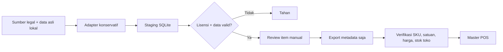

# Panduan Intake Dataset Barang Non-Makanan

**Status:** Dua konverter lokal diuji secara otomatis. Tidak mengunduh file publik, tidak memberi izin penggunaan ulang, dan tidak menambah stok/harga POS.

## 1. Jalur Open Products Facts

Sumber: https://world.openproductsfacts.org/  
Lisensi dataset: ODbL 1.0 (atribusi dan kemungkinan kewajiban database turunan/share-alike). Belum disetujui untuk dicampur dengan master privat toko. Lihat [audit sumber](SOURCE_AUDIT_2026-11-18.md).

**Input:** File ekspor Open Products Facts CSV/TSV atau .gz yang diperoleh secara sah dan disimpan lokal. Wajib mempunyai kolom `code,product_name,categories_tags,countries_tags`. Kolom `brands` opsional.

```bash
# Unduh file ekspor secara sah lebih dulu dan simpan sebagai data/private/openproductsfacts.csv.gz
python -m tools.prepare_opf --input data/private/openproductsfacts.csv.gz --out data/private/opf_candidates.csv --limit 300

# Hasil tetap tertahan di staging, karena status sumber PENDING
python -m tools.stage_dataset --db data/private/staging.db ingest --source OPF_NONFOOD_INDONESIA --csv data/private/opf_candidates.csv
python -m tools.stage_dataset --db data/private/staging.db report
```

**Seleksi:** hanya `countries_tags` eksplisit `en:indonesia` / `id:indonesia`, kategori non-food yang dipetakan secara konservatif, GTIN checksum valid, dan nama tidak kosong. Semua kolom yang tidak dipetakan (termasuk harga, nama pelanggan) dibuang. `PCS` hanya unit sementara untuk review, bukan konfirmasi satuan jual barang.

**Keterbatasan:** produk lokal Indonesia tanpa tag negara atau kategori sesuai akan terlewat. Proses ini tidak membuktikan bahwa produk tersebut tersedia di toko, dan hasil bisa saja **0 kandidat**. Perlu inspeksi lisensi sebelum izin per-record.

## 2. Jalur Master Spare Part Bengkel

Sumber yang sedang dipertimbangkan: [Mendeley: Workshop Transaction Records](https://data.mendeley.com/datasets/bwyxwynbg5/1). Lisensi landing page CC BY 4.0, tetapi isi mencakup data pelanggan dan transaksi. Ambil **lembar master part saja** bila tersedia dan telah diperiksa, lalu simpan sebagai CSV di folder privat; jangan mengunggah data pelanggan/transaksi ke GitHub.

**Nama kolom asli belum diverifikasi.** Contoh di bawah memakai nama kolom *ilustratif* `PartCode`, `PartName`, `Group`, `Brand`. Sesuaikan argument setelah memeriksa header berkas asli:

```bash
python -m tools.prepare_spareparts --input data/private/masterparts.csv --out data/private/sparepart_candidates.csv --id-column PartCode --name-column PartName --group-column Group --brand-column Brand --limit 1000

python -m tools.stage_dataset --db data/private/staging.db ingest --source ID_MENDELEY_MOTORPARTS_2026 --csv data/private/sparepart_candidates.csv
python -m tools.stage_dataset --db data/private/staging.db report
```

Output **tidak** memuat customer_name, kontak, alamat, riwayat servis, harga, stok, atau kode transaksi. Kode part bukan barcode GTIN. Kategori pertama `SPARE_PARTS` perlu diperinci oleh reviewer; tidak boleh otomatis menjadi SKU final.

## 3. Lapisan persetujuan dan promosi data



Saat ini seluruh **5 sumber eksternal PENDING**, sehingga kandidat yang berasal dari sumber tersebut ditahan di `HOLD_LICENSE`. Perubahan status memerlukan pemeriksaan izin dan catatan bukti yang dapat diaudit. Jangan gunakan URL placeholder sebagai bukti.

CSV hasil export dari staging tidak sama dengan template impor POS. SKU, harga, stok dan threshold harus diverifikasi di toko terlebih dahulu; tidak ada fungsi otomatis yang menggabungkannya.

## 4. Pengujian

```bash
python -m unittest discover -s tests -v
```

Test menggunakan berkas buatan sendiri, **bukan data asli Mendeley atau Open Products Facts**. Bukti tes dapat diperiksa di GitHub Actions.

## 5. Target pengumpulan data asli

- 1 berkas sumber non-makanan yang berhasil diunduh secara sah dan lolos pemeriksaan lisensi/privasi.
- Hasil kurasi dengan validasi kategori, unit dan GTIN sesuai tipenya.
- Minimal 30 SKU nyata dari rak toko sendiri untuk pengujian skema; data sumber publik tidak menggantikannya.
- Penetapan satuan meter vs pcs dan atribut pembeda ukuran baut harus dilakukan berdasarkan kondisi produk nyata.

**Belum tercapai:** 0 produk eksternal yang disetujui dan 0 SKU nyata terverifikasi.
