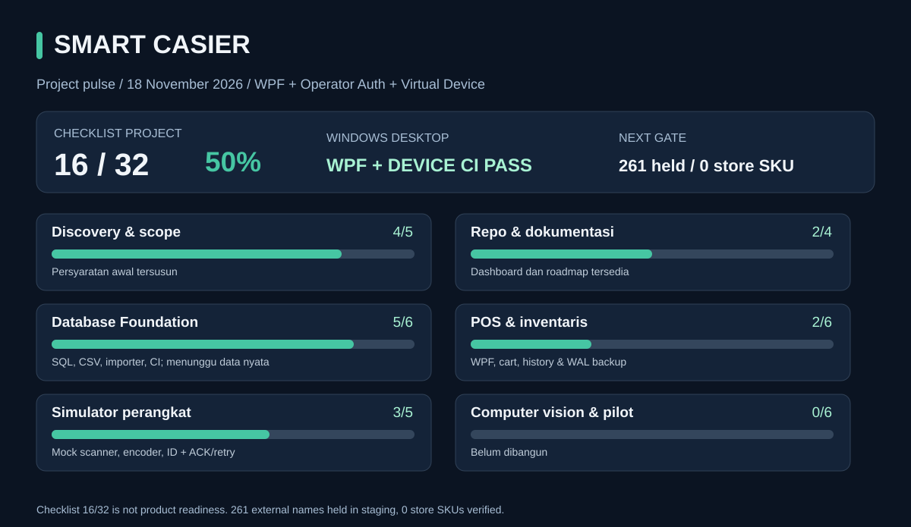

# Laporan Progres — Smart Casier

**EXECUTION MODE: SOFTWARE_ONLY** — [detail keputusan dan daftar tugas fisik ditunda](EXECUTION_POLICY_SOFTWARE_ONLY.md). Tugas lapangan tidak dihapus atau di-centang. Ketiadaan 30 SKU nyata tidak memblokir development aplikasi dengan fixture sintetis.

**Per 18 November 2026** · Tahap **Discovery → Persiapan Master Data**

## Ringkasan terverifikasi

- **11/32 checklist selesai (34%):** termasuk 5 pekerjaan fondasi database. Angka bukan persentase kesiapan aplikasi.
- **Aplikasi POS belum dibangun.** Migrasi dan importer SQLite telah di-commit dan 11 tes database lulus di GitHub Actions; belum ada inventaris toko asli, firmware, maupun integrasi hardware.
- **Repository:** [Skyreaaa/smart-casier](https://github.com/Skyreaaa/smart-casier), private, branch main.
- **Tugas aktif berikutnya:** audit 4 sumber kandidat non-makanan dan mengumpulkan 30 SKU toko nyata memakai template katalog; tidak ada sumber eksternal yang disetujui untuk impor otomatis.
- **Risiko utama:** variasi barang tanpa barcode, ukuran benda yang mirip, satuan stok meter/pcs, ketepatan ukur untuk penetapan harga, dan kelayakan metrologi legal.

## Checklist berdasarkan bukti pekerjaan

Status: `[x]` selesai dibahas/disediakan; `[ ]` belum selesai. Semua pekerjaan yang berstatus selesai ditelusuri dari keputusan percakapan atau repository ini, bukan klaim pengujian.

### 1. Discovery & scope — 4/5

- [x] **SC-REQ-01** — Definisi POS general offline-first
- [x] **SC-REQ-02** — Fallback manual dan konfirmasi akhir kasir
- [x] **SC-REQ-03** — Batas hardware Rp10 juta; PC tersedia
- [x] **SC-REQ-04** — Alur panjang -> pilih produk/warna -> konfirmasi
- [ ] **SC-REQ-05** — [DEFERRED_ON_SITE] Validasi kebutuhan lewat contoh barang dan observasi toko

### 2. Repository & dokumentasi — 2/4

- [x] **SC-OPS-01** — Repository GitHub private tersedia
- [x] **SC-OPS-02** — Dashboard progres + roadmap di repository
- [ ] **SC-OPS-03** — Issue backlog terstruktur
- [ ] **SC-OPS-04** — Review dan persetujuan acceptance criteria

### 3. Fondasi database — 5/6

- [x] **SC-DAT-01** — Kamus data produk, kategori, varian, satuan
- [x] **SC-DAT-02** — ERD dan aturan relasi SKU/variant
- [x] **SC-DAT-03** — Template CSV dan validasi impor
- [ ] **SC-DAT-04** — [DEFERRED_ON_SITE] 30 SKU sampel yang diverifikasi
- [x] **SC-DAT-05** — Migrasi schema SQLite
- [x] **SC-DAT-06** — Tes integritas database dan stok

### 4. POS & inventaris — 0/6

- [ ] **SC-POS-01** — CRUD master produk dan pencarian
- [ ] **SC-POS-02** — Varian dan satuan pcs/meter
- [ ] **SC-POS-03** — Keranjang dan transaksi dasar
- [ ] **SC-POS-04** — Pergerakan stok + peringatan ambang per SKU
- [ ] **SC-POS-05** — Checkout, pembayaran, struk dan riwayat
- [ ] **SC-POS-06** — Backup/restore dan penanganan gangguan

### 5. Simulator perangkat — 0/5

- [ ] **SC-DEV-01** — Kontrak adapter hardware
- [ ] **SC-DEV-02** — Simulasi barcode scanner
- [ ] **SC-DEV-03** — Simulasi encoder/display panjang
- [ ] **SC-DEV-04** — Draft pengukuran + pilih material/warna
- [ ] **SC-DEV-05** — Uji error/disconnect dan mode manual

### 6. Visi komputer & pilot — 0/6

- [ ] **SC-AI-01** — [DEFERRED_ON_SITE untuk kamera nyata; simulasi software tetap lanjut] Benchmark kamera dan kalibrasi
- [ ] **SC-AI-02** — Baseline pencarian kandidat visual
- [ ] **SC-AI-03** — Estimasi ukuran + penolakan kandidat ambigu
- [ ] **SC-AI-04** — [DEFERRED_ON_SITE] Integrasi perangkat fisik
- [ ] **SC-AI-05** — [DEFERRED_ON_SITE + LEGAL] Pemeriksaan persyaratan metrologi legal
- [ ] **SC-AI-06** — [DEFERRED_ON_SITE] Pilot, metrik akurasi dan waktu transaksi

## Aturan fase software-only

- Semua bukti cek alat, SKU asli, observasi toko, akurasi dan legal metrologi dicatat `DEFERRED_ON_SITE` dalam [execution policy](EXECUTION_POLICY_SOFTWARE_ONLY.md).
- Fase implementasi POS **diizinkan dimulai sekarang** memakai database dan data sintetis; bukan menunggu validasi fisik.
- Dasbor 11/32 tetap merefleksikan checklist yang *benar-benar* sudah selesai; tugas fisik yang ditunda tidak dianggap selesai.

## Gate dan definisi selesai

| Gate | Harus terbukti sebelum naik fase | Status |
| --- | --- | --- |
| G0 — Scope | Kebutuhan disetujui, data sampel toko mewakili jenis SKU & satuan | Belum lulus (observasi toko belum ada) |
| G1 — Database | Migrasi SQLite + test integritas + import/rollback valid | Baseline teknis lulus CI; belum lulus validasi 30 SKU nyata |
| G2 — POS | Transaksi offline, stok konsisten, backup/restore teruji | Belum dimulai |
| G3 — Alat ukur | Panjang aktual dibanding referensi pada variasi material; error handling | Belum dimulai |
| G4 — Commercial | Kewajiban metrologi legal dikonfirmasi; perangkat dinyatakan layak sesuai ketentuan | Belum diperiksa |
| G5 — AI | Evaluasi identifikasi SKU, rejection ambiguous, latency pada PC target | Belum dimulai |

## Bukti pekerjaan database

- [Migrasi SQLite](../database/migrations/001_core.sql), [importer CSV](../tools/import_catalog.py), [template kosong](../data/templates/catalog_products.csv), [contoh sintetis](../data/examples/catalog_demo.csv).
- [Tes regresi](../tests/test_database.py) dan [GitHub Actions berhasil](https://github.com/Skyreaaa/smart-casier/actions/runs/44265209926) pada commit 5c7edd6.
- Database produksi dan data toko nyata **belum dibuat**. Tes yang lulus tidak membuktikan kesiapan kasir komersial.

## Dataset staging non-makanan — tambahan yang sudah diimplementasikan

- [x] Filter kategori non-makanan dan guard tambahan untuk indikasi makanan yang salah kategori.
- [x] Prototipe staging SQLite, registry sumber, validasi GTIN, deduplikasi, dan larangan memasukkan data langsung ke POS.
- [x] Adapter lokal Open Products Facts (hanya non-food bertag Indonesia) dan spare part (hanya kolom master, tanpa data pelanggan/transaksi).
- [x] Adapter PRDECT-ID untuk mengambil nama non-makanan dari kategori relevan; ulasan, lokasi, harga, dan atribut pelanggan tidak disalin.
- [x] Data riil PRDECT-ID telah diproses **dalam staging pengujian terpisah**: 261 kandidat metadata, seluruhnya ditahan `HOLD_LICENSE` (bukan SKU terverifikasi).
- [x] Persetujuan record dan sumber dengan jejak audit, termasuk penahanan kembali ketika sumber ditolak.
- [x] **47 pengujian lulus:** [hasil CI](https://github.com/Skyreaaa/smart-casier/actions/runs/44273327558).
- [ ] Lisensi/privasi sumber eksternal ditinjau dan disetujui untuk ekstraksi data nyata.
- [x] Berkas sumber PRDECT-ID berhasil diakses dan dikonversi; status hak pakai/privasi dan identitas SKU toko masih menunggu peninjauan.
- [ ] Minimal 30 SKU toko nyata dan lisensi sumber eksternal dikonfirmasi untuk promosi data ke master.
- [ ] Setidaknya 30 SKU toko nyata diverifikasi.

Enam sumber eksternal (termasuk Open Products Facts dan PRDECT-ID e-commerce Indonesia) tercantum dalam [registry](../data/sources/nonfood_registry.json) dengan status `PENDING`. Satu fixture sintetis internal berstatus `APPROVED` **hanya untuk pengujian**, bukan izin penggunaan data nyata. **Progres global tetap 11/32**: staging merupakan pekerjaan pendukung, tidak menggantikan tugas validasi 30 SKU asli.

## Audit data nyata (bukan data master toko)

[Laporan audit faktual](REAL_NONFOOD_INTAKE_2026-11-18.md) mencatat:

- Open Products Facts: 49.771 baris total, 233 bertag Indonesia, **0** lolos pemetaan kategori toko secara eksplisit.
- PRDECT-ID: 5.400 baris ulasan; 1.000 kategori terpilih; **261** kandidat nama produk setelah penolakan dan deduplikasi; **261 HOLD_LICENSE**.
- Lisensi PRDECT-ID mengklaim CC0 dari metadata, tetapi file LICENSE kosong dan hak data ulasan aslinya belum diverifikasi; data tetap tidak dipromosikan.
- Barang yang diverifikasi secara fisik di toko: **0 SKU**.

## Prioritas pengumpulan data

1. Katalog produk dengan SKU internal yang stabil; barcode opsional.
2. Kategori dan varian (material, warna, dimensi bila relevan); hindari kolom universal yang penuh null.
3. Satuan stok dasar (`pcs`, `m`) dan satuan penjualan, konversi eksplisit jika diperlukan.
4. Harga per varian; jumlah stok dan ambang restock terpisah.
5. Riwayat perubahan stok yang dapat diaudit; stok tidak sekadar diubah tanpa catatan.
6. Foto referensi dengan label SKU yang diverifikasi, hanya bila siap memulai dataset AI.

## Asumsi dan yang belum diketahui

- Belum ada data Excel/katalog produk yang diunggah; skema lulus uji sintetis tetapi belum diuji pada SKU toko nyata.
- RAB awal perangkat **Rp8.404.000 + Rp1.596.000 cadangan** adalah angka *perencanaan* dari pembahasan, bukan quote vendor terkonfirmasi; desain casing premium mungkin mengubah biaya.
- Batas Rp10 juta berlaku untuk hardware tambahan, tidak termasuk PC yang sudah ada.
- Lebar, kekakuan, dan jenis material gulungan belum diketahui; alat universal perlu prototipe sebelum menyatakan toleransi.
- Definisi teknis toleransi akurasi dan kelayakan metrologi legal belum final.

## Catatan pembaruan progres

Setiap penyelesaian task harus menyertakan bukti: commit/PR, dokumen desain yang direview, dataset terverifikasi atau hasil pengujian yang bisa direproduksi. Jangan mencentang task hanya karena sudah masuk roadmap.
