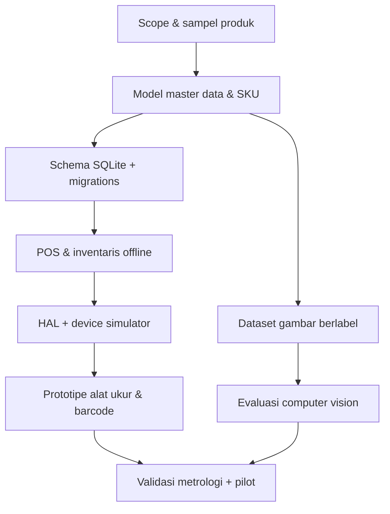

# Roadmap Implementasi Smart Casier

**Software milestone (18 November 2026):** [Windows WPF v0.1](WINDOWS_DESKTOP_V0_1.md), [POS Core](SOFTWARE_POS_CORE.md), input SKU dan edit harga/stok sudah tersedia. [Build dan tes lintas platform lulus](https://github.com/Skyreaaa/smart-casier/actions/runs/44280002437). Berikutnya histori transaksi, backup/restore, hak akses, dan simulator; pemeriksaan fisik tetap [DEFERRED_ON_SITE](EXECUTION_POLICY_SOFTWARE_ONLY.md).

> **Prioritas aktif: SOFTWARE_ONLY.** [Daftar tugas kunjungan/alat fisik ditunda](EXECUTION_POLICY_SOFTWARE_ONLY.md). Software boleh dilanjutkan dengan fixture sintetis; gate fisik tetap wajib sebelum operasional toko.

> Durasi estimasi untuk tim kecil; **bukan tanggal rilis yang sudah dijanjikan**. Hardware/ML mengikuti validasi tahap sebelumnya.

**Update 18 November 2026:** Adapter [Open Products Facts + master spare part](NONFOOD_INTAKE.md) tersedia dan [audit sumber](SOURCE_AUDIT_2026-11-18.md) dicatat. Data nyata terverifikasi tetap 0 SKU.

**Update 18 November 2026:** Pipeline [staging dataset non-makanan](DATASET_STAGING.md) juga telah dibuat dengan registry asal data, validasi barcode, filter non-food, review lisensi dan audit. Dataset eksternal yang disetujui dan data stok toko masih **nol**.

**Update 18 November 2026:** Database Foundation v0.1 sudah tersedia: [skema SQL](../database/migrations/001_core.sql), [template CSV](../data/templates/catalog_products.csv), [panduan](DATABASE_FOUNDATION.md) dan 11 tes CI lulus. **Pending:** 30 SKU toko nyata. Fase POS belum dimulai.

| Fase | Target urutan | Hasil minimum | Ketergantungan |
| --- | --- | --- | --- |
| 0. Kebutuhan dan baseline | Minggu 1–2 | Spesifikasi + contoh SKU toko | Observasi lapangan |
| 1. Data & skema lokal | Minggu 2–4 | Kamus data, template katalog, SQLite + tes | Fase 0 |
| 2. POS core & inventaris | Minggu 4–8 | Penjualan offline, inventaris, alert, backup | Fase 1 |
| 3. Simulator perangkat | Minggu 7–10 | Adapter barcode + encoder virtual, draft measurement | Fase 2 |
| 4. Prototipe hardware & test | Minggu 9–14 | Kamera, barcode, roller & alarm diuji | Fase 3, komponen tersedia |
| 5. Pilot toko dan metrologi | Setelah fase 4 | Uji toko, toleransi dan persyaratan legal dipenuhi | Fase 4 |
| 6. Vision SKU spesifik | Setelah POS stabil | Benchmark visual + dimensi, ketidakpastian ditangani | Dataset nyata |

## Perubahan urutan kerja 18 November 2026

- **Sekarang:** implementasi SQLite POS Core, pencarian, inventaris, transaksi atomik, tampilan Windows, laporan dan simulator perangkat.
- **Tidak memblokir coding:** observasi toko, 30 SKU nyata, pembelian/perakitan hardware, uji kamera fisik, kalibrasi mekanik dan uji toko. Semuanya `DEFERRED_ON_SITE`.
- **Belum boleh deploy komersial:** hasil ukur fisik belum diverifikasi dan persyaratan metrologi legal belum diselesaikan.
- Estimasi minggu di bawah adalah baseline lama; jadwal pelaksanaan berubah mengikuti fokus software.

## Dependensi visual

## Konsep data yang akan dikumpulkan

- **Produk inti:** id internal, SKU, nama, kategori, tipe (fisik/digital/jasa), status, barcode opsional.
- **Varian:** material, warna, diameter, ukuran, nomor part, atribut spesifik; tiap varian jual memiliki SKU unik.
- **Satuan:** unit dasar penyimpanan serta unit jual (`pcs`, `meter`), faktor konversi bila valid.
- **Harga:** harga jual per SKU & satuan, dengan catatan historis agar laporan masa lalu tidak berubah.
- **Stok:** ledger mutasi masuk, keluar, penyesuaian, retur, dan saldo turunan; threshold rendah per SKU.
- **Pengukuran:** event sensor ber-ID unik, target/aktual, status error/konfirmasi, dikaitkan ke item transaksi setelah kasir memilih produk.
- **AI:** foto SKU yang sudah diverifikasi, metadata sudut, pencahayaan, dan split train/validation/test; bukan data transaksi otomatis.

## Kriteria desain awal

- Barcode gagal dan AI ambigu tidak menghentikan jalur pencarian manual.
- Barang satuan dan barang meteran tidak dicampur satuan stoknya.
- Data penjualan dan stok tetap tersedia tanpa koneksi internet.
- Pengukuran tidak otomatis menjadi transaksi sebelum kasir memilih material/warna dan konfirmasi.
- Sebelum perangkat ukur memengaruhi harga jual nyata, ketentuan tera/metrologi harus diperiksa ke otoritas terkait.
- Casing premium bukan syarat pertama; optik, roller dan keselamatan lebih dahulu diuji.

## Anggaran perangkat (baseline, perlu survei)

| Area | Alokasi awal |
| --- | ---: |
| Perangkat tambahan termasuk scanner, kamera awal, sensor, encoder, display, printer, daya, casing sederhana dan pengujian | Rp8.404.000 |
| Cadangan | Rp1.596.000 |
| **Batas maksimum** | **Rp10.000.000** |

Tidak termasuk biaya engineering, pembelian PC, pengurusan metrologi yang mungkin timbul, atau casing custom premium di luar baseline.
