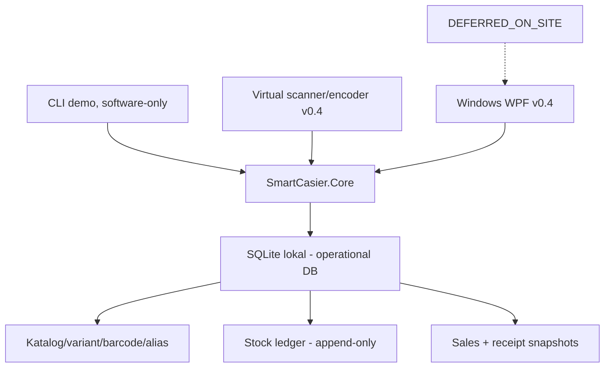

# Smart Casier — Software POS Core v0.1 (arsip)

> **Dokumen historis v0.1.** Versi terbaru: [operator + simulator v0.4](VIRTUAL_DEVICE_PROTOCOL_V0_4.md). CLI checkout tanpa login **telah dinonaktifkan**. Gunakan GUI WPF dengan akun operator.

**Mode:** SOFTWARE_ONLY, tanpa alat fisik dan tanpa data toko riil.  
**Platform:** .NET 10 (C#) + SQLite (offline), CLI lintas platform; antarmuka Windows grafis belum dibuat.  
**Hasil CI:** [Windows dan Linux PASS](https://github.com/Skyreaaa/smart-casier/actions/runs/44276517575).

## Sudah tersedia

- `src/SmartCasier.Core`: database bootstrap + katalog + checkout atomik + receipt.
- `src/SmartCasier.Cli`: CLI lokal untuk inisialisasi, seed demo, pencarian, laporan stok dan pembayaran kas.
- `database/migrations/003_pos_sales.sql`: tabel `sales`, `sale_lines`, snapshot harga saat transaksi.
- `tests/SmartCasier.Core.SelfTests`: **13 skenario** stok, nominal, meteran, rollback, idempotensi, restart, pencarian dan validasi.
- `.github/workflows/pos-core.yml`: build dan tests otomatis pada Windows dan Linux.

Semua data contoh diberi label **SYNTHETIC DEMO**. Tidak ada SKU fisik, harga jual toko, atau data produk publik yang telah diotorisasi dipakai sebagai data produksi.

## Menjalankan demo offline

Syarat: **.NET SDK 10** pada Windows (belum dibutuhkan barcode/camera/encoder).

Dari folder root repository:

```powershell
dotnet run --project src/SmartCasier.Cli -- init --db data/private/demo-pos.db
dotnet run --project src/SmartCasier.Cli -- seed-demo --db data/private/demo-pos.db --confirm-synthetic
dotnet run --project src/SmartCasier.Cli -- search --db data/private/demo-pos.db --query "baut"
dotnet run --project src/SmartCasier.Cli -- stock --db data/private/demo-pos.db
```

Replay dan idempotensi checkout kini diuji oleh suite POS Core otomatis dengan sesi operator aktif, bukan lewat CLI tanpa login.

Baris meteran memakai `--qty 2.5` (2,5 meter) dan SKU `KMY-MERAH`. Harga di mata uang rupiah integer; panjang/stok disimpan milli-unit (1 meter = 1000, 1 pcs = 1000). Stok habis 0; menipis bila positif dan lebih kecil dari ambang per SKU (default 3 pcs).

## Arsitektur dan data



**Penting:** `001_core.sql` dan `003_pos_sales.sql` adalah migrasi **database operasional**. `002_dataset_staging.sql` adalah migrasi untuk **file SQLite staging berbeda**, bukan langkah yang dijalankan di DB POS.

Penjualan ber-ID request unik, dilakukan dalam satu transaksi SQLite. Replay request dengan payload sama mengembalikan receipt sebelumnya; request ID yang sama dengan payload berbeda ditolak. Pembayaran kurang, stok tidak mencukupi, kuantitas `PCS` pecahan, atau SKU invalid menggagalkan seluruh checkout tanpa perubahan stok.

## Belum diimplementasikan (jangan disamakan dengan selesai)

- GUI WPF dasar, input SKU parsial dan histori sudah dibuat pada v0.4; CRUD lengkap dan laporan menyeluruh masih backlog.
- Pembayaran selain uang tunai, pajak/diskon, retur/pembatalan, role admin/kasir, pengaturan toko, printer struk, backup/restore otomatis.
- Produk DIGITAL/SERVICE seperti pulsa belum bisa checkout; butuh lifecycle fulfillment online dan error/retry yang jelas.
- Seluruh hardware adapter/perangkat fisik, kamera AI, kalibrasi dan metrologi.
- Uji operasional toko, verifikasi SKU nyata, penilaian keamanan produk.

**Next software sprint:** GUI WPF berbasis Core + CRUD master produk + inventaris, lalu backup/restore dan device simulator. Lihat [kebijakan software-only](EXECUTION_POLICY_SOFTWARE_ONLY.md).
